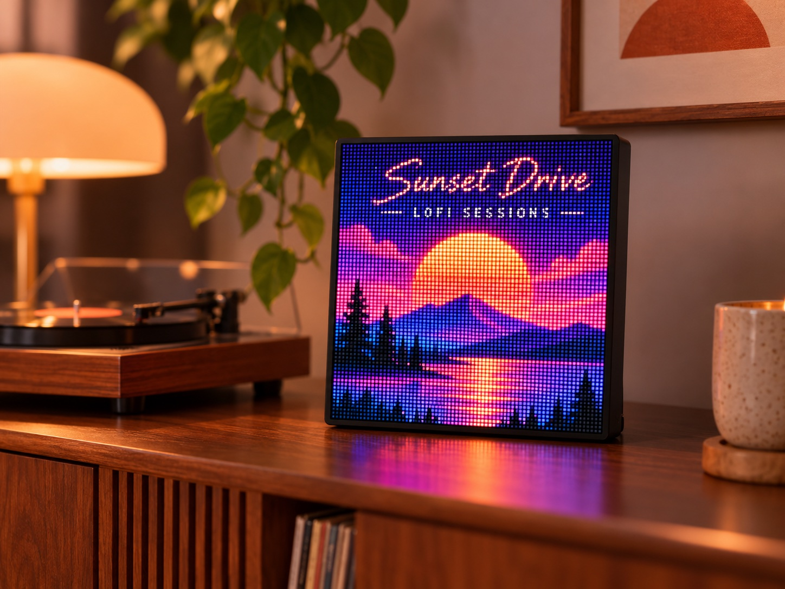
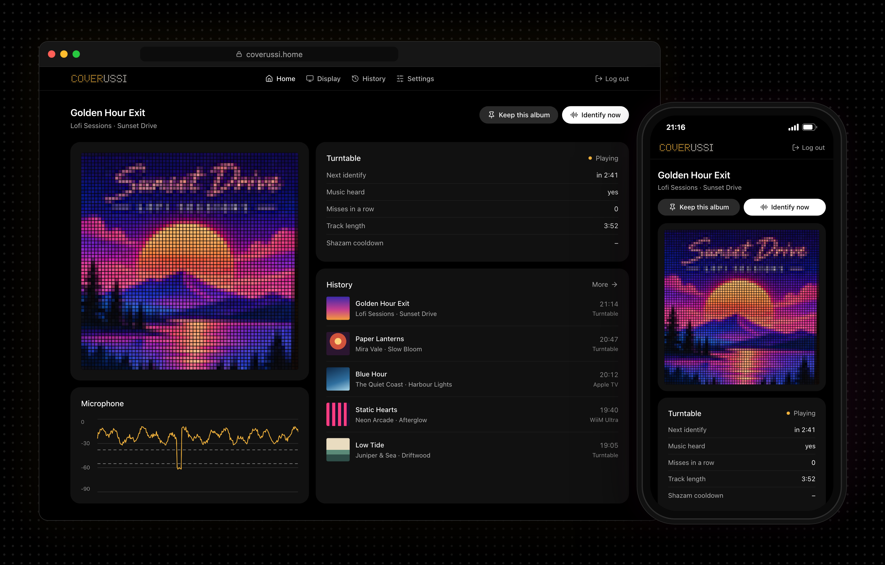

<h1></h1>

A 64 × 64 LED panel that shows the album cover of whatever you're playing, records included.



## For records, tapes and CDs

Most album art displays get the cover from Spotify or another streaming service. That's no help if you play records, tapes or CDs, or anything else through an amp's analog input: nothing tells the display what's playing.

Coverussi listens. The board's microphones record a few seconds, Shazam identifies the song, and the cover is on the panel a moment later. It hears the gap between tracks and the end of a side, and picks up the next song by itself.

Records are identified on the board with [shazamio](https://github.com/shazamio/shazamio-core)'s signature code. No account or API key needed.

## Streaming too

Smart players (a WiiM, an Apple TV, a Sonos: anything Home Assistant knows about) already report what they play, so for those the display takes the art straight from Home Assistant.

## Built around Home Assistant

The display follows the players and inputs you pick there, shows up in it as a light you can automate, and never talks to Spotify or Apple Music itself.

Everything runs on the board, the web app too.



## What you need

| Part | Notes |
| --- | --- |
| [Waveshare ESP32-S3-RGB-Matrix](https://www.amazon.com/dp/B0GYDRPTV4) | The board. It has the HUB75 connector, two microphones and the button the firmware uses |
| [Waveshare 64 × 64 P2.5 HUB75 panel](https://www.amazon.com/dp/B0BQYFRVTR) | 160 × 160 mm |
| 5 V 3 A USB-C charger | Into the board's POWER port. The web app works out what your brightness settings need |
| Home Assistant | The core. Records can do without it by turning on Listen for music, which treats any music in the room as an analog source |

## Set up

See [docs/setup.md](docs/setup.md).

## Development

| Part | Where |
| --- | --- |
| Display engine | `crates/app/` (Rust) |
| Firmware | `firmware-rs/` (Rust, ESP-IDF) |
| Web app | `portal/` (Svelte), served by the board |

Tests:

```sh
cargo test                        # the display engine
cd portal && npm run check        # the web app's types
```

`scripts/esp32-rs.sh --qemu build --release && scripts/qemu-rs.sh` runs the firmware in Espressif's QEMU.

The design, decisions and pin map are in [docs/PRD.md](docs/PRD.md).

## License

MIT, in [LICENSE](LICENSE).

Pin assignments and codec setup follow Waveshare's [ESP32-S3-RGB-Matrix examples](https://github.com/waveshareteam/ESP32-S3-RGB-Matrix) (Apache-2.0).
